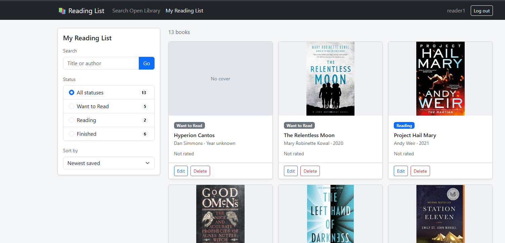
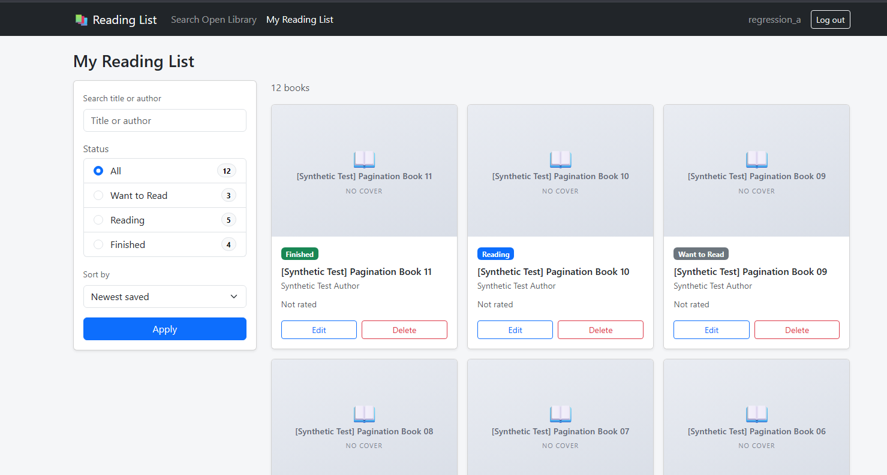

# Project #2: Building With APIs

## Question 1 - Defend Your Research Decision
For Project #2, I chose the Open Library API because I wanted to build a website where users could search for books and keep track of their reading. Open Library was a good choice because it provides book titles, authors, publication years, and cover images. I also liked that I could use its search API without having to register for an API key.

During the research phase, I compared Open Library with TheMealDB and the Art Institute of Chicago API. TheMealDB was another option because it provides recipe information, but it did not offer the same pagination features that I wanted for searching through results. The Art Institute of Chicago API had detailed documentation, but some of its advanced search features seemed more complicated than what I needed for this project.

I looked at the official documentation for each provider instead of choosing an API without researching it. Open Library's Search API documentation explained how to search for books and request specific information. Its Covers API documentation explained how to display cover images. Both features were useful for the application I wanted to build.

My research and comparisons are documented in docs/research/api-options.md. The official sources included the Open Library Search API, the Open Library Covers API, and the TheMealDB API documentation.

Overall, I chose Open Library because it matched my project idea, provided the information I needed, and was straightforward enough for me to work with while learning how APIs function.

## Question 2 - Explain One Prototype Decision
One design question I wanted to answer with my prototype was how to organize the reading-list page so users could easily see their saved books while also being able to search, filter, and sort them. I wanted the website to be organized and easy to understand.

I explored three layouts. Layout A displayed the books in a table, Layout B displayed them as cards with a sidebar, and Layout C used a compact list grouped by reading status. The table would have worked for displaying information, but I thought the card layout looked better for books. The grouped list was another possibility, but it could become confusing when there were enough books to require multiple pages.

I decided to use Layout B because I liked seeing the book covers and details displayed on individual cards. I also liked having the search box, reading-status filters, and sorting options in one sidebar instead of spreading those controls around the page.

The prototype is saved in prototypes/reading-list-layouts.html, and the design decision is explained in prototypes/README.md.

The completed application uses the selected design in books/templates/books/book_list.html. The sidebar is implemented in books/templates/books/includes/filter_sidebar.html, and the different reading-status badges are implemented in books/templates/books/includes/status_badge.html.

The prototype helped me compare different designs before building the actual Django page. It also gave me an opportunity to improve how the filtering controls worked in the completed application.

## Question 3 - Trace Your API Update
My second Python script is api_script.py. This script connects to the API I created with Django, retrieves a list of saved books, and allows the user to update a book's reading status.

The script first sends a GET request to /api/books/ to retrieve saved books. After the user chooses a book and selects a new status, it sends a PATCH request to /api/books/<id>/. The PATCH request includes JSON containing the new reading status, such as {"status": "reading"}.

The PATCH request is made in api_script.py, around lines 70–74. The script uses an authentication token from the READING_LIST_TOKEN environment variable. It places that token in the Authorization header so Django can identify the user without having the token written directly into the code.

The request first goes through config/urls.py, line 13, which includes the API routes from books.api_urls. In books/api_urls.py, line 11, the URL pattern books/<int:pk>/ routes the request to BookDetailAPIView.

The view is defined in books/api.py, around lines 30–44. It uses Django REST Framework's RetrieveUpdateDestroyAPIView to handle the PATCH request. The view restricts its queryset to books belonging to the authenticated user. This prevents someone from changing another user's saved book by entering its ID.

The data is checked by SavedBookSerializer in books/serializers.py, lines 8–37. The serializer allows updates to status, rating, and notes, but it protects fields such as the title and author. The model in books/models.py also defines the valid reading statuses.

After the request is validated, Django REST Framework saves the changes to the SQLite database and returns the updated book information in the API response. The script then displays the status before and after the update.

I verified this with a live test using my saved copy of Dune. I changed its status from Finished to Reading through the script. I then opened the website and confirmed that the book displayed the Reading badge and that the reading-status count changed. After verifying the update, I used the script to change the status back to Finished.

There is also an automated test in books/tests/test_api.py, starting around line 311, that uses refresh_from_db() to verify that changes were saved to the database.

This process helped me understand how a Python script sends a request to a Django API, how the API checks permissions and validates the information, and how the updated record gets saved.

## Question 4 - Trace and Verify Your Data
The page I chose for this question is My Reading List, located at /books/. This page displays saved books for the logged-in user and allows searching, filtering, sorting, and pagination.

The URL is defined in books/urls.py, line 8, and connects to BookListView. The view is implemented in books/views.py, starting around line 166.

The view first retrieves books belonging to the logged-in user. On line 186, it uses SavedBook.objects.filter(user=self.request.user). This makes sure users only see their own saved records.

The search, filtering, and sorting logic is implemented in books/filters.py. Around line 61, the code uses these Q objects:

Q(title__icontains=search) | Q(author__icontains=search)

The Q objects combine two search conditions using OR. This means a saved book matches when the search text appears in either its title or its author. The icontains lookup also makes the search case-insensitive.

Status filtering is handled around line 66 with queryset.filter(status=status). This lets the user narrow the results to Want to Read, Reading, or Finished. If no specific status is selected, the page can display books from all three statuses.

Sorting is also handled in books/filters.py using Django's order_by() method. The options include newest saved, oldest saved, title, and author. For example, choosing Title (A–Z) arranges the matching books alphabetically by title.

Pagination is implemented in books/views.py, around lines 172–182. The page displays 10 books at a time. If more than 10 books match the selected search and filters, Django divides the results into multiple pages. The pagination links preserve the search, status, and sorting options so users do not lose their selections when moving between pages.

I tested this feature manually using a separate regression database so I would not change the original project's data. One test account had 12 saved books, including synthetic records created specifically to test pagination.

When I opened My Reading List, the first page showed 10 books and the second page showed the remaining two. I also tested searching by author, filtering by reading status, and sorting by Title (A–Z).

The results matched the code. The Q objects determined which titles or authors matched the search, the status filter narrowed the results, sorting controlled the order, and pagination divided the matching books into pages of 10.

This helped me understand how Django database queries control the information displayed on a webpage.

## Question 5 - Push Back on the Agent
During development, testing helped identify problems that needed to be corrected before the application was finished.

One problem involved saving the same book twice. The earlier implementation could cause a server error instead of handling the duplicate properly. Another problem involved the reading-list count, which could display only the number of books on the current page instead of the total number saved. There was also an issue with my second API script where selecting a valid book that was not on the first page could cause an error.

These problems were discovered through automated testing and corrected before their phases were committed. The testing and fixes are documented in PROMPTS.md.

When I manually tested the completed website, I did not find any new bugs. I checked searching, saving books, editing reading statuses, deleting books, filtering, sorting, pagination, and making sure different users could not see each other's saved books. Everything I tested worked as expected.

One usability improvement I reviewed and approved was adding an Apply button to the reading-list sidebar.

In the original prototype, changing a status filter or sorting option immediately updated the displayed books using JavaScript. There was no separate Apply button. During planning, Claude Code recommended changing this behavior so the final Django application would use a regular form with an Apply button.

I liked that idea and approved it because I preferred being able to select the search, reading status, and sorting options before applying them together. I also thought having an Apply button made the sidebar easier to understand.

The completed application uses a GET form in books/templates/books/includes/filter_sidebar.html. Clicking Apply submits the selected options to Django, which updates the displayed results.

I captured two screenshots to show the difference between the original prototype and the completed application.

Before: Original prototype without an Apply button

After: Completed Django reading list with an Apply button

The before screenshot comes from the original prototype file, which I reopened after development. It is not a screenshot of a bug in the finished website. The Apply-button change was recommended during planning and approved by me, rather than being a bug I discovered during later manual testing.

This project showed me why it is important to check the work produced by an AI coding agent. Automated tests helped catch problems that were not obvious just from looking at the website, and manual testing helped me confirm that the finished features worked correctly.

The prototype also helped me make decisions about how the application should look and function instead of just accepting the first design. Overall, I learned more about how APIs, Django views, serializers, database queries, and templates work together to create a functioning application.

